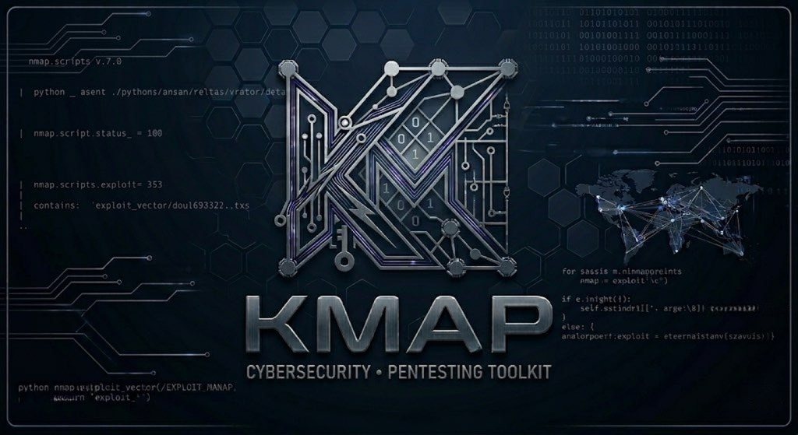

<p align="center">
  
</p>

# Kmap

**Kmap** is a command-line [Nmap](https://nmap.org/) fork for network discovery,
service identification and attack-surface research. It adds a
**discover → enrich → store → query** pipeline, local SQLite storage, watchlist
change reports and tools for exploring relationships between collected assets.

**Use only on systems you own or have explicit written permission to test.**
See [LICENSE](LICENSE) for this Nmap-derived project's public-source terms and
[third-party notices](docs/3rd-party-licenses.txt) for bundled components.

## Background: the NSA and mapping the internet

Kmap's framing draws on the history of large-scale internet reconnaissance:

- **TREASUREMAP** — Snowden-era reporting described the NSA and its Five Eyes
  partners seeking a near-real-time map of the internet, including network
  infrastructure and end-user devices. [DER SPIEGEL, 2014](https://www.spiegel.de/international/world/snowden-documents-indicate-nsa-has-breached-deutsche-telekom-a-991503.html).
- **HACIENDA** — GCHQ's country-wide port-scanning program catalogued exposed
  services to support intelligence operations. [Heise, 2014](https://www.heise.de/hintergrund/NSA-GCHQ-The-HACIENDA-Program-for-Internet-Colonization-2292681.html).
- **Equation Group** — Kaspersky's 2015 investigation described a sophisticated
  cyber-espionage actor; contemporary reporting linked it to the NSA, while
  noting attribution uncertainty. Kaspersky later connected tools in the
  Shadow Brokers leak to Equation malware. [Kaspersky](https://www.kaspersky.com/about/press-releases/equation-group-the-crown-creator-of-cyber-espionage),
  [WIRED](https://www.wired.com/2015/02/kapersky-discovers-equation-group),
  [Shadow Brokers analysis](https://securelist.com/the-equation-giveaway/75812/).

That history illustrates how discovery and mapping can inform later operations.
Services such as [Shodan](https://www.shodan.io/) and [Censys](https://censys.io/)
bring internet asset discovery into commercial research. Kmap focuses on running
your own collection and analysis workflow, with results stored locally.

## Capabilities

| Area | Main options |
|---|---|
| Nmap-derived scanning | Port/service detection, OS fingerprinting and NSE scripts |
| Per-host assessment | `--web-recon`, `--cve-map`, `--default-creds`, `--screenshot` |
| Discovery and monitoring | `--net-scan`, `--watchlist`, phase-specific runs and `--net-resume` |
| Search and correlation | `--net-query`, `--search`, `--net-cluster`, `--entity-graph` |
| Network paths | `--tracemap`, `--topo-export` |
| Output and tuning | `-oJ`, `--report`, `--color`, `--efficient`, `--fast` |

Collected metadata can include service versions, TLS/SSH/web fingerprints,
ASN/country information, derived tags and CVE matches with CVSS, EPSS and CISA
KEV fields. Availability depends on the target, enabled features and local data.

## Build

### Linux, macOS and BSD

Use a C++17 compiler and the configure/make build. On Debian/Ubuntu:

```sh
sudo apt install build-essential git libssl-dev libpcap-dev libssh2-1-dev
git clone https://github.com/YurilLAB/Kmap.git
cd Kmap
./configure
make -j2
sudo make install
```

Other Unix platforms need equivalent compiler and library packages. The checked-in
`configure` script is ready to use; regenerating it requires Autoconf.
Keep Kmap's runtime data files, including `kmap-cve.db`, available to the binary.

### Windows

Install Visual Studio C++ build tools, a Windows SDK and CMake. Subversion and
internet access are needed when the build script must fetch missing dependencies.
From the repository root:

```bat
mswin32\Build.bat Build Release
```

The solution produces **Win32/x86** binaries under `mswin32\Release\`.
See the [Windows build guide](docs/windows-build.md) for dependency layout,
runtime DLLs and troubleshooting. Raw-packet modes require Npcap; screenshots
require a supported installed browser.

## Quick start

These examples use loopback; substitute only authorized targets:

```sh
# Service detection, with a resumable normal log
kmap --unprivileged -sT -sV -n -p 80,443 -oN scan.nmap 127.0.0.1

# Web/CVE assessment and a fresh Markdown report
kmap --unprivileged -sT -Pn -n --web-recon --cve-map -p 80,443 --report findings.md 127.0.0.1
```

For monitoring, put approved IPs/CIDRs in `assets.txt`, then collect and query:

```sh
kmap --net-scan --watchlist assets.txt -p 80,443 --rate 100
kmap --net-query --nq-port 443 --nq-count
kmap --net-query --nq-format json --nq-output results.json
```

The pipeline defaults to `kmap-data/` for its 32 SQLite shards and `Findings/`
for reports. Use `--data-dir` and `--findings-dir` to choose separate locations.
`--discover-only`, `--enrich-only` and `--report-only` split the pipeline into
phases. See `kmap --help` for options and the guides below for complete workflows.

Refresh vulnerability data with [update_cves.py](scripts/update_cves.py) and
[update_epss_kev.py](scripts/update_epss_kev.py), or import local records with
`--import-cves`. Refresh scripts require Python and network access.

## Important limits and responsible use

- **Scope and rate:** an unscoped `--net-scan` targets public IPv4 space, and
  its discovery rate is unlimited by default. Choose an explicit scope and rate
  appropriate for your authorization and network. Review exclusions, honor
  opt-outs and provide an abuse contact for research scans.
- **Separate scan paths:** ordinary scans use the Nmap-derived engine;
  `--net-scan` uses its own discovery and simplified enrichment. Do not assume
  identical NSE, OS or service-detection coverage between them. Raw discovery
  needs suitable privileges/capture support; a TCP connect fallback is available.
- **Findings need validation:** banners, versions and the age/completeness of
  `kmap-cve.db` affect CVE matches. A match is not proof of exploitability;
  no match is not proof that a system is patched. Performance depends on hardware,
  targets and enabled features; benchmark figures are not throughput guarantees.
- **Dependencies and privacy:** optional features need their supporting libraries,
  browser or data. Enrichment can contact external DNS/ASN services;
  `KMAP_NO_DNS=1` and `KMAP_NO_ASN=1` disable those respective lookups.
- **Resume/output:** `-oJ` and `--report` are completed-run snapshots and cannot
  be used with `--append-output` or ordinary `--resume`. Use `-oN`/`-oG` logs for
  resumable ordinary scans; `--net-resume` is the separate pipeline mechanism.

Credential checks and web-path probing are active tests. Obtain permission for
the specific checks you enable and follow applicable laws and provider policies.
The authors assume no liability for misuse.

## Documentation

| Guide | Contents |
|---|---|
| [Scanning and watchlists](docs/internet-scale-scanning.md) | Discovery, phases, scope, exclusions, storage and resume |
| [Querying](docs/querying.md) | Filters, CVE metadata and exports |
| [Pivoting and topology](docs/pivoting-and-topology.md) | Fingerprint correlation and path graphs |
| [Findings reports](docs/findings-report.md) | Reading generated results |
| [Data model](docs/data-model.md) | Shards, schema and rescan semantics |
| [Performance](docs/performance.md) / [benchmarks](bench/README.md) | Resource tuning and measurement methodology |
| [Testing](docs/testing.md) | Local fixtures, regression checks, sanitizers and fuzzing |
| [Troubleshooting](docs/troubleshooting.md) | Common setup and runtime issues |
| [Nmap-derived manual](docs/kmap.1) | Traditional scan options (`man kmap`) |

Design proposals live in [the performance roadmap](docs/performance-roadmap.md),
[async discovery design](docs/async-discovery-design.md) and
[asset-intelligence design](docs/asset-intelligence-design.md); they are plans,
not evidence that every proposed capability is implemented.
